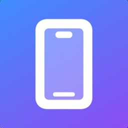
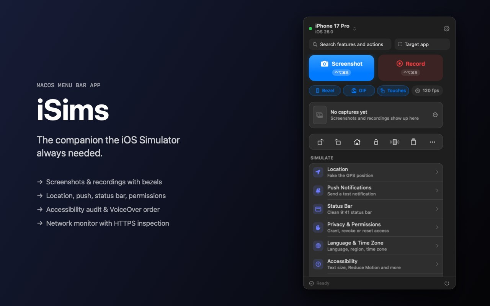
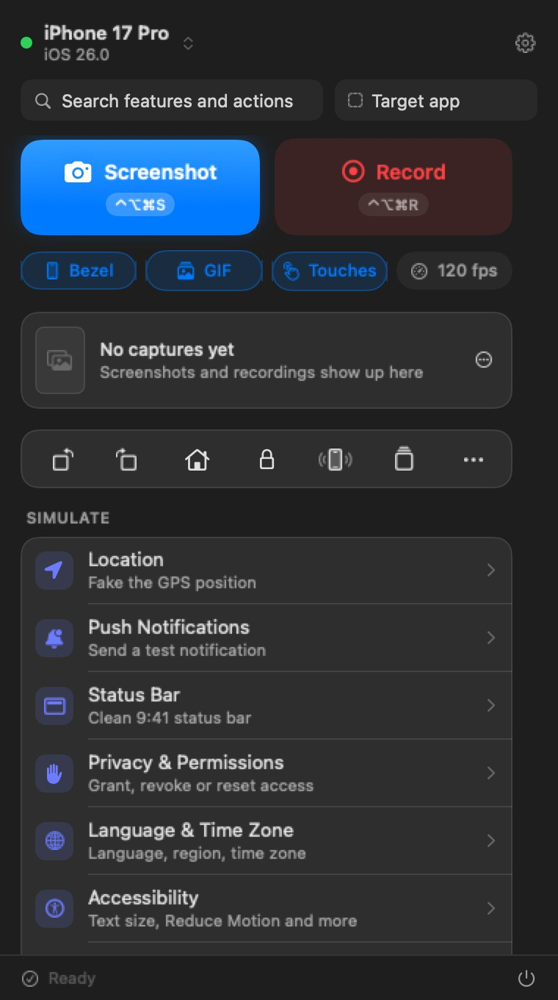
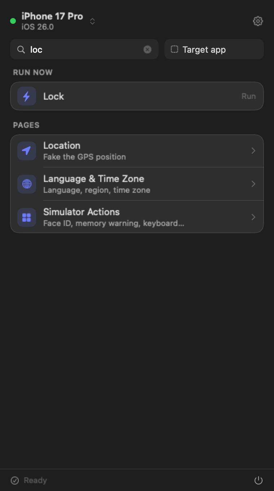
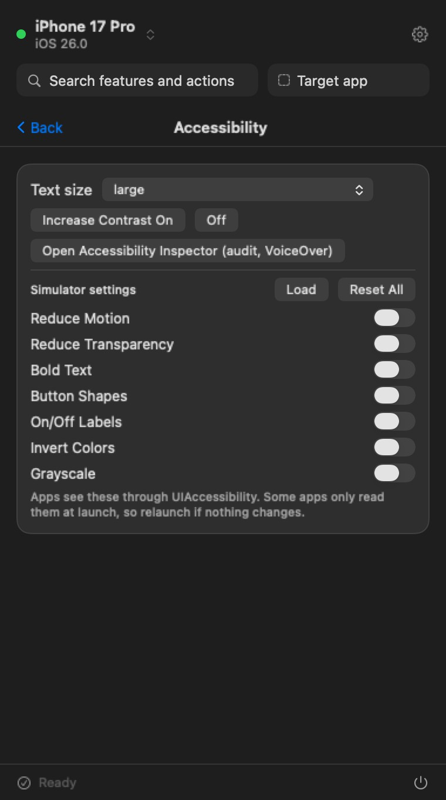
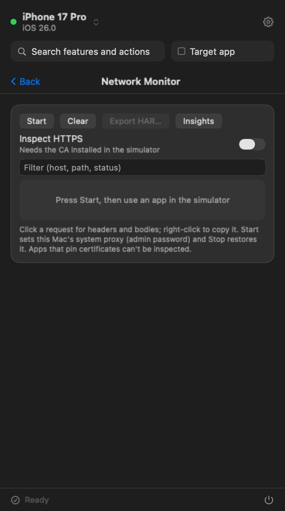
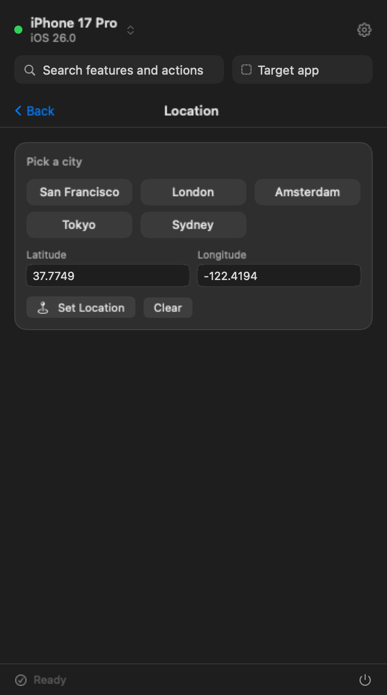
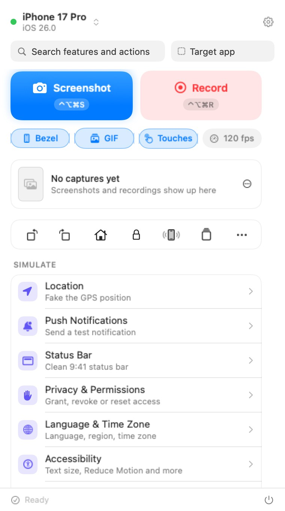

<h1 align="center">iSims</h1>

<b>The companion the iOS Simulator always needed.</b> A macOS menu bar app for iOS developers: capture, control & inspect any simulator from one window.

   
  ▶ <a href="media/tour.mp4">Watch the 27-second tour</a>

> **Showcase repo.** The source code is private. This repo holds screenshots, a video tour and the feature list.

## Screenshots

| Home | Search | Accessibility |
|:-:|:-:|:-:|
|  |  |  |
| **Network Monitor** | **Location** | **Light mode** |
|  |  |  |

## Features

**Capture**
- Screenshots with device bezels, a floating thumbnail and a post editor (backgrounds, caption, shadow); export at App Store Connect sizes
- Screen recording with GIF export, touch circles drawn into the video, optional 120 fps window capture
- Global shortcuts (⌃⌥⌘S screenshot, ⌃⌥⌘R record, ⌃⌥⌘D dark/light), rebindable

**Control the simulator**
- Boot / shut down; install, launch, terminate & uninstall apps; add photos, videos & contacts
- Deep links, push notifications, location, a clean 9:41 status bar, privacy permissions
- Language, region & time zone overrides; dark mode, Dynamic Type, contrast
- Accessibility switches: Reduce Motion / Transparency, Bold Text, Button Shapes, Invert, Grayscale
- Simulator actions (rotate, home, lock, shake, Face ID, memory warning) and Home Screen Quick Actions
- UserDefaults editor and app container reveal

**Inspect**
- Accessibility audit (missing labels, tap targets under 44 pt, duplicates) and a VoiceOver-order navigator
- Network monitor: local proxy, optional HTTPS inspection, decoded bodies (gzip, deflate, Brotli), copy as cURL or **for AI** with credentials redacted, HAR export
- Network speed throttling, design overlay, grid & guides, magnifier, build insights from DerivedData

**Teams, devices & AI**
- A committed `.isims.json` shares bundle IDs, deep links, pushes & locations across the team
- Physical devices via `devicectl`, iPhone screen mirroring over USB, a simulator camera feed package
- `isims` command line (`isims screenshot --bezel`, `isims audit --json`, `isims record --gif` …) and two bundled **Claude Code skills**, so coding agents can drive the simulator

## Built with

Swift 6 · SwiftUI · AppKit · Swift Package Manager (no Xcode project) · `simctl` / `devicectl` · AVFoundation · Network.framework

---
Made by [Anil Upadhyay](https://github.com/anil291987) · [LinkedIn](https://www.linkedin.com/in/anil-u-a70061a7/)
